# Metric dictionary

Every KPI in this project is defined once, in [`sql/03_marts/03_metrics.sql`](../sql/03_marts/03_metrics.sql), and documented here. The dashboard and the business questions in `sql/05_analysis/` read only these definitions. Gate 2 tests that every metric view adds back up to the warehouse (`test_07_metric_ties.sql`) and that the rules below hold (`test_08_metric_rules.sql`). Decisions referenced as D-numbers are in [`decisions.md`](decisions.md).

## Rules

1. **Every ratio is sum ÷ sum at the level shown**, never an average of row-level ratios (D04). Ratios are SQL macros that take sums, such as `ctr(sum(clicks), sum(impressions))`. To roll a view up, re-aggregate its base columns and reapply the macro. Never average or sum a ratio column.
2. **Rates need volume.** CTR is compared only with at least 30 clicks and CVR only with at least 30 conversions (`min_rate_events()`, D03), and CTR carries a Wilson 95% interval. Below the threshold a segment shows as "low volume", not as a rate. Criteo campaigns are scored only with at least 50 attributed conversions (`min_campaign_conversions()`, D17). The other 285 of 675 campaigns, with 8.2% of revenue, are pooled as "long tail".
3. **Money carries its unit in the column name.** `_fen` is iPinYou money in Chinese fen (CPM prices, so one impression costs pay_price ÷ 1000 fen, D29). `_idx` is Criteo money in transformed units: report ratios and relative changes, never absolute amounts.
4. **Criteo dates follow the money.** Media cost is booked by impression day and revenue by conversion day (D13). Margin and return on media cost are shown only for the whole period or the middle weeks, never as a daily line (D14).
5. **Two Criteo reporting windows** (D36):
   - *Whole period*: impression days 0–30 plus every conversion they produced (conversion days 0–60). No conversion lags more than 30 days, so this P&L is complete. 18.6% of its revenue books on days 31–60.
   - *Middle weeks*: days 7–27 (weeks 1–3), used for weekly comparisons. Conversion-dated revenue on day *d* holds about P(lag ≤ *d*) of its steady-state value: 82% on day 7, 90% on day 14 and 95% on day 21, or 86%, 92% and 97% averaged over weeks 1–3. Raw week-over-week revenue growth inside this window therefore overstates demand by about 8 points (week 1 to 2) and 5 points (week 2 to 3), so weekly revenue changes are shown raw and lag-adjusted (D40).
6. **iPinYou counts each auction once.** Duplicate impression log rows are collapsed (D27), so impressions, clicks and spend here sit slightly below the paper's Table 3, which counts log rows. The gate 2 reconciliation uses the paper's convention and matches it exactly (D29).

## KPI driver tree

Every revenue number is a product of a few drivers, so any change traces back to the driver that moved. To answer "revenue dropped, why?", walk one row from left to right: which driver moved, and by how much. The Criteo row defines the three effects in the Q15 weekly revenue bridge.

```mermaid
flowchart LR
    subgraph iPinYou["iPinYou · buyer's spend (fen)"]
        S[Spend] --> B[Bids]
        S --> WR[Win rate]
        S --> CPM["CPM ÷ 1000"]
        WR -.-> RPM["RPM = win rate × CPM"]
        CPM -.-> RPM
        CPM -.-> EC["eCPC = CPM ÷ (1000 × CTR)"]
    end
    subgraph Criteo["Criteo · platform revenue (idx)"]
        R[Revenue] --> CV[Conversions]
        R --> AR[Attribution rate]
        R --> CPO[Average CPO]
        CV --> CL[Clicks]
        CV --> CVR[CVR]
        CL --> IM[Impressions]
        CL --> CTR[CTR]
        M["Gross margin = revenue − media cost"]
    end
```

| Dataset | Identity | Reads as |
| :- | :- | :- |
| iPinYou | Spend = bids × win rate × CPM ÷ 1000 | More auctions, more wins, or a higher clearing price |
| iPinYou | RPM = win rate × CPM | Revenue per 1,000 bid requests: the primary metric for the floor-price test (Q7) |
| Criteo | Revenue = conversions × attribution rate × average CPO | Volume, attribution and price & mix effects (Q15) |
| Criteo | Conversions = impressions × CTR × CVR | Over the whole period only: conversions are conversion-dated, clicks impression-dated |

## iPinYou metrics (buyer's view)

| Metric | Definition | SQL | Unit | Caveat |
| :- | :- | :- | :- | :- |
| Bids | Bid requests iPinYou bid on | `bids` | count | The log holds only requests iPinYou bid on, not every request it saw |
| Impressions | Won auctions, each counted once | `impressions` | count | 0.4% of auctions are logged more than once and counted once (D27) |
| Win rate | Impressions ÷ bids | `win_rate()` | ratio | Fill-rate proxy. True fill rate needs all ad requests, which the data does not have |
| Spend | Σ pay_price ÷ 1000 over won auctions | `spend_fen` | fen | The buyer's media spend, and so the exchanges' revenue from this buyer |
| CPM | Spend ÷ impressions × 1000, i.e. the average paying price | `cpm()` | fen per 1,000 | ÷ 100 for RMB. This is also the market price: the second-highest bid |
| Clicks | Clicked won auctions, deduplicated | `clicks` | count | 87 clicks with no impression row are excluded (D31) |
| CTR | Clicks ÷ impressions | `ctr()`, `wilson_low()`, `wilson_high()` | ratio | About 0.07%, so 30 clicks need roughly 40,000 impressions |
| eCPC | Spend ÷ clicks | `ecpc()` | fen | |
| CVR | Conversions ÷ clicks | `cvr()` | ratio | Per click, as the iPinYou paper defines it. Only advertiser 3358 reaches 30 conversions |
| RPM | Spend ÷ bids × 1000 | `rpm()` | fen per 1,000 bids | |
| Bid headroom | Σ max(bid − pay, 0) ÷ Σ bid over won auctions | `bid_headroom()` | ratio | Bids are fixed, deliberately high test bids, so headroom is inflated (D23). Negative values from the 1.55% of auctions paying above the bid are floored at zero (D33) |

## Criteo metrics (intermediary's view)

| Metric | Definition | SQL | Unit | Caveat |
| :- | :- | :- | :- | :- |
| Impressions | Impression rows | `impressions` | count | Sub-sampled release (D38) |
| Clicks | Σ click | `clicks` | count | |
| CTR | Clicks ÷ impressions | `ctr()` | ratio | About 36%, a product of the release's sub-sampling. Compare across Criteo campaigns and weeks only (D38) |
| eCPC | Media cost ÷ clicks | `ecpc()` | idx | |
| Conversions | Conversion × campaign pairs | `conversions` | count | Every conversion row has a click, so conversions are post-click (D38) |
| CVR | Conversions ÷ clicks | `cvr()` | ratio | Whole period or campaign level. In a short window it divides conversion-dated by impression-dated counts |
| Media cost | Σ cost | `media_cost_idx` | idx | What Criteo paid for the inventory |
| Platform revenue | Σ cpo over attributed conversion × campaign pairs, using the cpo on the last impression before the conversion | `revenue_idx` | idx | Counted once per conversion × campaign (D02, D28) |
| Average CPO | Revenue ÷ attributed conversions | `avg_cpo()` | idx | Moves with campaign mix as well as price, hence "price & mix" in Q15 |
| Gross margin | Revenue − media cost | `margin_idx` | idx | Booked-date view (D14) |
| Margin % | Gross margin ÷ revenue | `margin_pct()` | ratio | Whole period or middle weeks only (D14) |
| Return on media cost | Revenue ÷ media cost | `return_on_media_cost()` | ratio | A platform-side proxy, **not advertiser ROAS**: ROAS needs order value, which the data lacks |
| Attribution rate | Attributed conversions ÷ all conversions | `attribution_rate()` | ratio | A low rate means conversions the platform drove but was not paid for. Mix-affected over time: long-lag conversions are attributed far less often (D37) |
| Active campaigns | Campaigns with at least one impression in the period | `active_campaigns` | count | A campaign stands in for an advertiser |
| New campaigns | First impression in week *w* | `new_campaigns` | count | Blank for week 0, which mixes existing and new campaigns (D05, D39) |
| Churned campaigns | Impressions in week *w* − 1, none in week *w* | `churned_campaigns` | count | Weeks 1–3 only (D39) |
| Spend retention | A cohort's media cost in week *w* ÷ its media cost in its first week | built in Q12 | ratio | Week-0 cohort labelled "existing" (D05) |
| Revenue concentration | Revenue share of the top 10% of campaigns (68 of 675), and the Herfindahl index Σ share² | `top_decile_revenue_share`, `revenue_hhi` | ratio, 0–1 | Whole period. HHI × 10,000 gives the antitrust scale |

## Views

Each view states its grain and carries its base columns, so it can be rolled up safely.

| View | Grain | Use |
| :- | :- | :- |
| `metrics_ipy_hourly` | advertiser × hour × exchange | Dayparting, exchange comparison, dashboard page 3 |
| `metrics_ipy_advertiser` | advertiser | Market overview (Q1), dashboard KPIs |
| `metrics_criteo_day` | day 0–60 | Daily volume and cost, the 7-day trend (Q8, Q9). No margin or CVR: those would divide conversion-dated by impression-dated values |
| `metrics_criteo_week` | week 0–8 | Weekly KPIs with week-over-week comparison on the middle weeks; activity, new and churned campaigns |
| `metrics_criteo_campaign` | campaign, whole period | Scorecard, segment matrix, Pareto curve (Q10, Q11, Q14) |
| `metrics_criteo_platform` | reporting window | Headline P&L KPI cards (dashboard page 1) |

Slot, size, visibility and floor-price cuts (Q3, Q5–Q7) aggregate `fact_auction` directly and apply the same macros.
